https://learn.microsoft.com/en-us/plans/p3x0u1w5qm8q5y

A data engineer integrates, transforms, and consolidates data from various structured and unstructured data systems into structures that are suitable for building analytics solutions. The data engineer also helps design and support data pipelines and data stores that are high-performing, efficient, organized, and reliable, given a specific set of business requirements and constraints.

## Get started with data engineering on Azure

There are four stages for processing big data solutions that are common to all architectures:

- **Ingest** - The ingestion phase identifies the technology and processes that are used to acquire the source data. This data can come from files, logs, and other types of unstructured data that must be put into the data lake. The technology that is used varies depending on the frequency that the data is transferred. For example, for batch movement of data, pipelines in Microsoft Fabric may be the most appropriate technology to use. For real-time ingestion of data, Azure Event Hubs, Azure Stream Analytics, or Microsoft Fabric Real-Time Intelligence may be an appropriate choice.
    
- **Store** - The store phase identifies where the ingested data should be placed. Azure Data Lake Storage Gen2 provides a secure and scalable storage solution that's compatible with commonly used big data processing technologies.
    
- **Prep and train** - The prep and train phase identifies the technologies that are used to perform data preparation and model training and scoring for machine learning solutions. Common technologies that are used in this phase are Azure Databricks, Microsoft Fabric, and Azure Machine Learning.
    
- **Model and serve** - Finally, the model and serve phase involves the technologies that present the data to users. These technologies can include visualization tools such as Microsoft Power BI, or analytical workloads in Microsoft Fabric. Often, a combination of multiple technologies is used depending on the business requirements.

### Azure Data Lake Storage

Many organizations have spent the last two decades building data warehouses and business intelligence (BI) solutions based on relational database systems. Many BI solutions have lost out on opportunities to store unstructured data due to cost and complexity in these types of data in databases. **Data lakes** have become a common solution to this problem. A data lake provides file-based storage, usually in a distributed file system that supports high scalability for massive volumes of data. Organizations can store structured, semi-structured, and unstructured files in the data lake and then consume them from there in big data processing technologies, such as Apache Spark. **Azure Data Lake Storage Gen2** provides a cloud-based solution for data lake storage in Microsoft Azure, and underpins many large-scale analytics solutions built on Azure.

Azure Data Lake Storage uses a layered access control model. Azure role-based access control (Azure RBAC) lets you grant coarse-grained access—such as read or write access to all data in a container—to users, groups, and service principals. Azure attribute-based access control (Azure ABAC) refines those role assignments by adding conditions, such as restricting access to data with a specific tag. For precise, file-level control, access control lists (ACLs) with Portable Operating System Interface (POSIX) permissions let you set permissions at the directory or file level.

Permissions aren't automatically inherited from parent directories after a child item is created. However, you can configure default permissions on a parent directory, which are then applied to new child items at the time they're created. You can manage these settings using utilities such as Azure Storage Explorer.

Data Lake Storage supports the Azure Storage redundancy options. Locally redundant storage (LRS) keeps multiple copies within a single data center, while zone-redundant storage (ZRS) replicates data across availability zones in the same region. For broader geographic protection, geo-redundant storage (GRS) or read-access geo-redundant storage (RA-GRS) replicates data to a secondary region. For the highest level of resilience, geo-zone-redundant storage (GZRS or RA-GZRS) combines zone and geographic redundancy. The options available depend on the storage account type: standard general-purpose v2 accounts support all of them, while premium block blob accounts support LRS and ZRS in certain regions.

Azure Data Lake Storage Gen2 isn't a standalone Azure service, but rather a configurable capability of an Azure Storage account. You can enable it on a **Standard general-purpose v2** account (the most common choice) or a **Premium block blob** account for workloads that require higher throughput and lower latency. To enable Azure Data Lake Storage Gen2 in an Azure Storage account, you can select the option to **Enable hierarchical namespace** in the **Advanced** page when creating the storage account in the Azure portal.

### Azure Blob Storage

In Azure Blob storage, you can store large amounts of unstructured ("object") data in a flat namespace within a blob container. Blob names can include "/" characters to organize blobs into virtual "folders", but in terms of blob manageability the blobs are stored as a single-level hierarchy in a flat namespace.

Azure Data Lake Storage Gen2 builds on blob storage and optimizes I/O of high-volume data by using a hierarchical namespace that organizes blob data into _directories_, and stores metadata about each directory and the files within it. This structure allows operations, such as directory renames and deletes, to be performed in a single atomic operation. Flat namespaces, by contrast, require several operations proportionate to the number of objects in the structure. Hierarchical namespaces keep the data organized, which yields better storage and retrieval performance for an analytical use case and lowers the cost of analysis.

If you want to store data _without performing analysis on the data_, leave the **Enable hierarchical namespace** setting cleared to set up the storage account as an Azure Blob storage account. You can also use blob storage to archive rarely used data or to store website assets such as images and media.

If you're performing analytics on the data, set up the storage account as an Azure Data Lake Storage Gen2 account by selecting the **Enable hierarchical namespace** setting. Because Azure Data Lake Storage Gen2 is integrated into the Azure Storage platform, applications can use either the Blob APIs or the Azure Data Lake Storage Gen2 file system APIs to access data.

## Azure Stream Analytics

### Introduction to Azure Stream Analytics

#### Basics

Today, massive amounts of real-time data are generated by connected applications, Internet of Things (IoT) devices and sensors, and various other sources. The proliferation of streaming data sources has made the ability to consume and make informed decisions from these data in near-real-time an operational necessity for many organizations.

Some typical examples of streaming data workloads include:

- Online stores analyzing real-time clickstream data to provide product recommendations to consumers as they browse the website.
- Manufacturing facilities using telemetry data from IoT sensors to remotely monitor high-value assets.
- Credit card transactions from point-of-sale systems being scrutinized in real-time to detect and prevent potentially fraudulent activities.

_Azure Stream Analytics_ provides a cloud-based stream processing engine that you can use to filter, aggregate, and otherwise process a real-time stream of data from various sources. The results of this processing can then be used to trigger automated activity by a service or application, generate real-time visualizations, or integrate streaming data into an enterprise analytics solution.

A data stream consists of a perpetual series of data, typically related to specific point-in-time events. For example, a stream of data might contain details of messages submitted to a social media micro-blogging site, or a series of environmental measurements recorded by an internet-connected weather sensor. Streaming data analytics is most often used to better understand change over time. For example, a marketing organization may perform sentiment analysis on social media messages to see if an advertising campaign results in more positive comments about the company or its products, or an agricultural business might monitor trends in temperature and rainfall to optimize irrigation and crop harvesting.

Common goals for stream analytics include

- Continuously analyzing data to report issues or trends.
- Understanding component or system behavior under various conditions to help plan future enhancements.
- Triggering specific actions or alerts when certain events occur or thresholds are exceeded.

Stream processing solutions typically exhibit the following characteristics:

1. The source data stream is _unbounded_ - data is added to the stream perpetually.
2. Each data record in the stream includes _temporal_ (time-based) data indicating when the event to which the record relates occurred (or was recorded).
3. Aggregation of streaming data is performed over temporal _windows_ - for example, recording the number of social media posts per minute or the average rainfall per hour.
4. The results of streaming data processing can be used to support real-time (or _near_ real-time) automation or visualization, or persisted in an analytical store to be combined with other data for historical analysis. Many solutions combine these approaches to support both real-time and historical analytics.

Once started, a Stream Analytics query runs perpetually, processing new data as it arrives in the input and storing results in the output.

Stream Analytics guarantees _exactly once_ event processing and _at-least-once_ event delivery, so events are never lost. Exactly once processing is guaranteed with selected outputs. For more information, see [Event delivery guarantees](https://learn.microsoft.com/en-us/stream-analytics-query/event-delivery-guarantees-azure-stream-analytics). Stream Analytics has built-in recovery capabilities in case the delivery of an event fails. Also, Stream Analytics provides built-in checkpointing to maintain the state of your job and produces repeatable results. Because Azure Stream Analytics is a platform-as-a-service (PaaS) solution, it's fully managed. Its built-in integration with various sources and destinations provides a flexible programmability model. The Stream Analytics engine enables in-memory compute, so it offers high performance.

The easiest way to use Azure Stream Analytics is to create a Stream Analytics **_job_** in an Azure subscription, configure its input(s) and output(s), and define the query that the job uses to process the data. The query is expressed using structured query language (SQL) syntax, and can incorporate static reference data from multiple data sources to supply lookup values that can be combined with the streaming data ingested from an input.

If your stream process requirements are complex or resource-intensive, you can create a Stream Analytics **_cluster_**, which uses the same underlying processing engine as a Stream Analytics job, but in a single-tenant deployment (so your processing isn't affected by other customers) and with configurable scalability that enables you to define the right balance of throughput and cost for your specific scenario.

#### Understanding event processing

The stream processing logic is encapsulated in a query. Queries are defined using SQL statements that _SELECT_ data fields _FROM_ one or more inputs, filter or aggregate the data, and write the results _INTO_ an output:

```sql
SELECT observation_time, weather_station, temperature
INTO cold-temps
FROM weather-events TIMESTAMP BY observation_time
WHERE temperature < 0
```

A field named **EventProcessedUtcTime** is automatically created to define the time when the event is processed by your Azure Stream Analytics query. By default, Stream Analytics uses the time the event arrives at the input as its timestamp, or you can explicitly specify another DateTime field by using the _TIMESTAMP BY_ clause, as shown in this example. Depending on the input from which the streaming data is read, one or more potential timestamp fields may be created automatically; for example, when using an _Event Hubs_ input, a field named **EventEnqueuedUtcTime** is generated to record the time when the event was received in the event hub.

#### Understanding window functions

A common goal of stream processing is to aggregate events into temporal intervals, or _windows_. For example, to count the number of social media posts per minute or to calculate the average rainfall per hour.

Azure Stream Analytics includes native support for [five kinds of temporal windowing functions](https://learn.microsoft.com/en-us/stream-analytics-query/windowing-azure-stream-analytics). These functions enable you to define temporal intervals into which data is aggregated in a query. The supported windowing functions are [Tumbling](https://learn.microsoft.com/en-us/stream-analytics-query/tumbling-window-azure-stream-analytics), [Hopping](https://learn.microsoft.com/en-us/stream-analytics-query/hopping-window-azure-stream-analytics), [Sliding](https://learn.microsoft.com/en-us/stream-analytics-query/sliding-window-azure-stream-analytics), [Session](https://learn.microsoft.com/en-us/stream-analytics-query/session-window-azure-stream-analytics), and [Snapshot](https://learn.microsoft.com/en-us/stream-analytics-query/snapshot-window-azure-stream-analytics).

**Tumbling** window functions segment a data stream into a contiguous series of fixed-size, non-overlapping time segments and operate against them. Events can't belong to more than one tumbling window.

The Tumbling window example, represented by the following query, finds the maximum reading value in each one-minute window. Windowing functions are applied in Stream Analytics jobs using the [GROUP BY](https://learn.microsoft.com/en-us/stream-analytics-query/group-by-azure-stream-analytics) clause of the query syntax. The `GROUP BY` clause in the following query contains the `TumblingWindow()` function, which specifies a one-minute window size.

```sql
SELECT DateAdd(minute,-1,System.Timestamp()) AS WindowStart,
       System.Timestamp() AS WindowEnd,
       MAX(Reading) AS MaxReading
INTO
    [output]
FROM
    [input] TIMESTAMP BY EventProcessedUtcTime
GROUP BY TumblingWindow(minute, 1)
```




```mermaid
gantt
    title Events & Sliding Windows (Max Reading per Minute)
    dateFormat X
    axisFormat %s
    tickInterval 10second

    section 3rd Minute
    Max reading 3.4     :active, w3, 0, 60s
    3.1                 :milestone, e1, 8, 0s
    3.4                 :milestone, e2, 18, 0s
    3.2                 :milestone, e3, 35, 0s
    2.8                 :milestone, e4, 50, 0s

    section 2nd Minute
    Max reading 2.9     :active, w2, 60, 60s
    2.7                 :milestone, e5, 70, 0s
    2.9                 :milestone, e6, 90, 0s
    2.6                 :milestone, e7, 110, 0s

    section 1st Minute
    Max reading 3.1     :active, w1, 120, 60s
    3.1                 :milestone, e8, 150, 0s
    3.0                 :milestone, e9, 170, 0s
```

**Hopping** window functions model scheduled overlapping windows, jumping forward in time by a fixed period. It's easiest to think of them as Tumbling windows that can overlap and be emitted more frequently than the window size. In fact, tumbling windows are simply a hopping window whose `hop` is equal to its `size`. When you use Hopping windows, events can belong to more than one window result set.

To create a hopping window, you must specify three parameters. The first parameter indicates the time unit, such as second, minute, or hour. The following parameter sets the window size, which designates how long each window lasts. The final required parameter is the hop size, which specifies how much each window moves forward relative to the previous one. An optional fourth parameter denoting the offset size may also be used.

```sql
SELECT DateAdd(second,-60,System.Timestamp()) AS WindowStart,
       System.Timestamp() AS WindowEnd,
       MAX(Reading) AS MaxReading
INTO
    [output]
FROM
    [input] TIMESTAMP BY EventProcessedUtcTime
GROUP BY HoppingWindow(second, 60, 30)
```


**Sliding** windows generate events for points in time when the content of the window actually changes. This function model limits the number of windows that need to be considered. Azure Stream Analytics outputs events for only those points in time when an event entered or exited the window. As such, every window contains a minimum of one event. Events in Sliding windows can belong to more than one sliding window, similar to Hopping windows.

```sql
SELECT DateAdd(minute,-1,System.Timestamp()) AS WindowStart,
       System.Timestamp() AS WindowEnd,
       MAX(Reading) AS MaxReading
INTO
    [output]
FROM
    [input] TIMESTAMP BY EventProcessedUtcTime
GROUP BY SlidingWindow(minute, 1)
```

**Session** window functions cluster together events that arrive at similar times, filtering out periods of time where there's no data. It has three primary parameters: timeout, maximum duration, and partitioning key (optional). The occurrence of the first event starts a session window. Suppose another event occurs within the specified timeout from the last ingested event. In that case, the window extends to incorporate the new event. However, if no other events occur within the specified timeout period, the window closes at the timeout. If events keep happening within the specified timeout, the session window extends until the maximum duration is reached.

The following query measures user session length by creating a `SessionWindow` over clickstream data with a `timeoutsize` of 20 seconds and a `maximumdurationsize` of 60 seconds. The `OVER (PARTITION BY user_id)` clause creates an independent session window for each user.

```sql
SELECT user_id,
       MIN(time) AS WindowStart,
       System.Timestamp() AS WindowEnd,
       DATEDIFF(second, MIN(time), System.Timestamp()) AS DurationInSeconds
INTO
    [output]
FROM
    [input] TIMESTAMP BY time
GROUP BY user_id, SessionWindow(second, 20, 60) OVER (PARTITION BY user_id)
```

**Snapshot** windows group events by identical timestamp values. Unlike other windowing types, a specific window function isn't required. You can employ a snapshot window by adding the `System.Timestamp()` function to your query's `GROUP BY` clause.

```sql
SELECT System.Timestamp() AS WindowTime,
       MAX(Reading) AS MaxReading
INTO
    [output]
FROM
    [input] TIMESTAMP BY EventProcessedUtcTime
GROUP BY System.Timestamp()
```


### Data Ingestion with Azure Stream Analytics

**Azure Stream Analytics** is a fully managed, cloud-based stream processing service that enables you to build real-time analytics pipelines. It connects to streaming data sources such as Azure Event Hubs, Azure IoT Hub, and Azure Data Lake Storage, processes data using a SQL-based query language, and writes results to a wide range of output destinations.

A typical pattern for real-time data processing in Azure includes these stages:

- A real-time source of data is captured in an event ingestor, such as Azure Event Hubs or Azure IoT Hub.
- The captured data is perpetually filtered, aggregated, or enriched by an Azure Stream Analytics query.
- The results of the query are written to one or more output destinations—such as a data lake, a relational database, or another event hub.

A common use case is to write stream processing results to a data lake hosted in Azure Data Lake Storage Gen2. Data stored in a data lake can later be processed and queried using batch analytics tools such as Apache Spark or serverless SQL engines. This approach is well suited to scenarios where you want to retain raw or lightly processed event data for historical analysis, compliance, or machine learning workloads.

When streaming results need to be available to applications or reporting tools that rely on relational data, you can write the output of a Stream Analytics job to a table in Azure SQL Database or an Azure Synapse Analytics dedicated SQL pool (for which Stream Analytics provides a dedicated Azure Synapse Analytics output). This approach enables dashboards and reports to query the most recently ingested data using standard SQL.

Azure Stream Analytics can also write filtered or enriched events to another Azure Event Hubs instance. This pattern is used to build multi-stage streaming pipelines, where one Stream Analytics job performs initial filtering or enrichment and forwards the results to a downstream consumer such as another job, an Azure Function, or a custom application.

A common pattern for streaming queries is to aggregate event data over temporal (time-based) intervals, or _windows_. To accomplish this, you can use a **GROUP BY** clause that includes a Window function defining the kind of window you want to define. Azure Stream Analytics supports five window types:

- **Tumbling** — fixed-size, non-overlapping, contiguous intervals. An event belongs to exactly one tumbling window.
- **Hopping** — overlapping scheduled windows that advance by a fixed hop interval. Events can belong to more than one window.
- **Sliding** — fire only when the window content changes (when an event arrives or leaves). Every window contains at least one event.
- **Session** — variable-length windows grouped by inactivity gap between events. Useful for IoT and user-activity scenarios where event bursts are separated by idle periods.
- **Snapshot** — groups events that share the same timestamp by adding `System.Timestamp()` to the `GROUP BY` clause.

The following example groups streaming sensor readings into 1 minute tumbling (serial, non-overlapping) windows, recording the start and end time of each window and the maximum reading for each sensor. The **HAVING** clause filters the results to include only windows where at least one event occurred.

```sql
SELECT
    DateAdd(second, -60, System.Timestamp()) AS StartTime,
    System.Timestamp() AS EndTime,
    SensorID,
    MAX(ReadingValue) AS MaxReading
INTO
    [output]
FROM
    [streaming-input] TIMESTAMP BY EventEnqueuedUtcTime
GROUP BY SensorID, TumblingWindow(second, 60)
HAVING COUNT(*) >= 1
```


